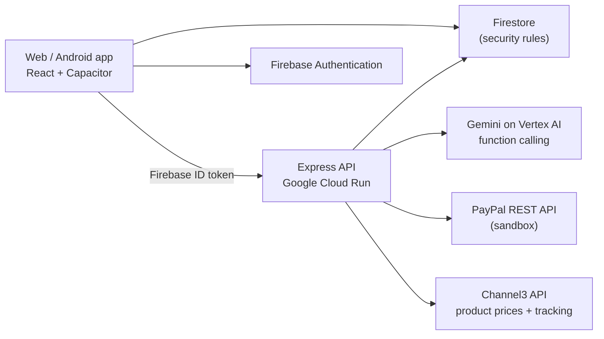

# Kova: Calm Money Companion

Kova is an AI money companion that explains your money in plain words and helps you act on it, calmly. For the PayPal AI Hackathon, Kova reads a PayPal account through the PayPal sandbox, flags what is worth a look, answers questions about it with Google Gemini, and cancels a forgotten subscription only after the user confirms.

- **Live demo:** https://kova-gkgwmqurbq-ew.a.run.app (judges: sign-in details are in the Devpost testing instructions)
- **Platforms:** web and Android (Capacitor)
- **License:** MIT

## What it does

**PayPal + AI**

- **PayPal Money Check-in.** Reads recent payments and subscriptions, explains them calmly, and flags unfamiliar charges (for example `XK*DGTL SVCS 4471`) and subscriptions with their yearly cost.
- **Ask Kova about your PayPal.** Plain-language questions ("What did I pay for on PayPal this month?", "Anything I should cancel?") are answered by a Gemini function-calling agent over the PayPal data. Each answer shows what it is based on, and every number in it comes from PayPal.
- **Actions only with the user's yes.** Kova can propose cancelling a subscription or drafting a dispute message. Nothing happens until the user taps the button; the cancel then goes through PayPal's Subscriptions API.

**Ask before you buy (Channel3)**

- **Real prices.** "Can I afford the Sony WH-1000XM6?" Kova looks the product up with Channel3's product search and shows the lowest in-stock price, the store and how many stores have it, then how the purchase fits the user's month and savings goal. Vague items ("headphones") still get "How much is it?", and a result is used only if its title contains every specific word the user typed.
- **Price watch.** Tap "I'll wait" and Kova watches the price for 30 days (Channel3 price tracking). When the user opens the app, Kova mentions only a real drop (at least 3%), with the old price, the new one and "lowest in 30 days" when Channel3's history confirms it.

**Without PayPal**

- Log spending by chatting ("Spent 12 on lunch").
- Import a statement CSV from a bank or wallet (PayPal's format is recognised). The file is read on the device; only rows the user confirms are saved.
- "Can I afford this?", a subscription radar that warns before renewals, savings goals, short lessons and a monthly letter.

## How it works



### PayPal APIs used (sandbox)

| API | Used for |
| --- | --- |
| `POST /v1/oauth2/token` | Server-to-server access token (client credentials) |
| `GET /v1/reporting/transactions` | Recent payments for the check-in and the agent |
| `GET /v1/billing/subscriptions/{id}` | Subscription status, plan and next billing date |
| `GET /v1/catalogs/products/{id}` | Readable names for subscription products |
| `POST /v1/billing/subscriptions/{id}/cancel` | Cancelling a subscription after the user confirms |

Code: [`server/paypal/`](server/paypal) (`realPaypal.ts` for the API, `checkin.ts` for flags, `agent.ts` for the Gemini agent, `routes.ts` for the endpoints).

### Channel3 APIs used

| API | Used for |
| --- | --- |
| `POST /v1/search` | Finding the product and its in-stock offers for "Can I afford…?" |
| `GET /v1/products/{id}` | Re-checking the exact product's price for a price watch |
| `POST /v0/price-tracking/start` | Starting price history when the user taps "I'll wait" |
| `GET /v0/price-tracking/history/{id}` | 30-day low, for "lowest in 30 days" |

Code: [`server/channel3.ts`](server/channel3.ts) (client and matching), [`server/priceWatch.ts`](server/priceWatch.ts) (watch rules), tests in `server/channel3.test.ts` and `server/priceWatch.test.ts`. Only the product name is sent to Channel3, never money data, and the key stays on the server.

### How the agent stays honest and safe

1. The model sees short references (`s1`, `p3`), never real PayPal IDs.
2. Its first step must be a tool call (`list_payments`, `list_subscriptions`, `spending_summary`, `propose_action`), so answers start from data.
3. The server drops any sentence containing a number the tools did not return, and drops unrequested advice.
4. Proposals become buttons. Only a confirmed tap reaches `POST /api/paypal/action`, which is locked against double taps.

These rules are unit-tested in [`server/paypal/agent.test.ts`](server/paypal/agent.test.ts) and [`server/paypal/checkin.test.ts`](server/paypal/checkin.test.ts).

## Tech stack

- **App:** React 19, TypeScript, Vite, Tailwind CSS 4, Capacitor 8 (Android)
- **Server:** Node.js, Express, Google Cloud Run
- **Data and sign-in:** Firebase Authentication, Cloud Firestore with security rules ([`firestore.rules`](firestore.rules))
- **AI:** Google Gemini on Vertex AI (`@google/genai`), Gemini 3.1 Flash-Lite and 3.6 Flash
- **Payments:** PayPal REST APIs (sandbox)
- **Product prices:** Channel3 (search, products, price tracking)
- **CI:** GitHub Actions: type check, build, tests, secret scan, container build ([`.github/workflows/ci.yml`](.github/workflows/ci.yml))

## Run it locally

You need **Node.js 22 or newer**, a **Firebase project** of your own, and optionally a **PayPal sandbox app**.

1. **Install:**
   ```bash
   npm ci
   ```
2. **Firebase:**
   - Create a Firebase project. Enable **Authentication** (Email/Password and Google) and **Cloud Firestore**.
   - Put your web app's config in [`firebase-applet-config.json`](firebase-applet-config.json) (`projectId`, `apiKey`, `authDomain`, `appId`, and `firestoreDatabaseId`, or `(default)`).
   - Set your database name in [`firebase.json`](firebase.json), then deploy the rules: `firebase deploy --only firestore:rules`.
   - Let the server use your Google login: `gcloud auth application-default login`.
3. **Environment:** copy `.env.example` to `.env` and set:
   - `FIREBASE_PROJECT_ID` and `FIRESTORE_DATABASE_ID` to your project.
   - Gemini: either `GEMINI_BACKEND=vertex` with `GOOGLE_CLOUD_PROJECT` (Vertex AI on your project), or leave `GEMINI_BACKEND` empty and set `GEMINI_API_KEY` (Google AI Studio key).
   - `PLAN_ADMIN_UIDS` to your own Firebase user ID after you sign up once. That account sees PayPal and can switch plans for testing.
4. **PayPal:**
   - **Without a sandbox app:** keep `PAYPAL_MODE=mock`. The check-in and agent run on built-in demo data.
   - **With the sandbox:** create an app at [developer.paypal.com](https://developer.paypal.com), set `PAYPAL_MODE=real`, `PAYPAL_CLIENT_ID` and `PAYPAL_CLIENT_SECRET`, then seed demo merchants, plans and subscriptions:
     ```bash
     npm run paypal:check
     npm run paypal:seed
     ```
     Approve the subscriptions as the sandbox buyer, then put the printed IDs in `PAYPAL_SUBSCRIPTION_IDS`.
5. **Channel3 (optional):** get a free key at [trychannel3.com](https://trychannel3.com) and set `CHANNEL3_API_KEY` in `.env`. Without it, "Can I afford…?" asks for the price instead.
6. **Start:**
   ```bash
   npm run dev
   ```
   Open http://localhost:3000, sign up, and try the PayPal check-in from the chat.

To try the statement import, upload [`docs/kova-demo-statement.csv`](docs/kova-demo-statement.csv) (more samples in [`samples/`](samples)).

### Checks

```bash
npm run lint   # TypeScript
npm test       # unit tests
npm run build  # web app + server bundle
```

### Android

See [`docs/ANDROID.md`](docs/ANDROID.md): `npm run build:android`, then build in Android Studio.

## Privacy and security

- No secrets in the code or the app bundle: the Gemini and PayPal secrets live on the server (Secret Manager in production).
- Firestore rules let users read only their own data and stop them changing their own plan.
- Statements are read on the device. Accounts can be exported or fully deleted from Settings ([`server/account.ts`](server/account.ts)).

## License

[MIT](LICENSE) © 2026 Ambora Labs
